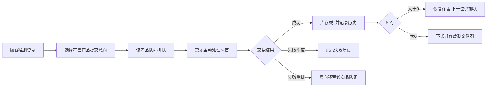

# OxStore

[](https://github.com/Wen5555/OxStore/actions/workflows/ci.yml)

**面向线下交付的轻量商品售卖系统。**

OxStore 迭代 2 后端提供多商品库存管理、顾客注册登录、按商品独立排队和成交历史接口。顾客登录后可提交固定数量为 1 的购买意向；卖家线下确认结果，成功时扣减库存。付款与交货仍在线下完成。

[功能](#功能) · [快速开始](#快速开始) · [本地开发](#本地开发) · [技术栈](#技术栈) · [文档](#文档)

## 功能

| 买家 API | 卖家 API |
| --- | --- |
| 注册/登录、商品浏览/搜索/二级类目筛选 | 多商品发布、库存与二级类目维护 |
| 浏览在售商品详情与多图、富文本描述 | 手动上架/下架、按商品查看意向队列 |
| 登录后提交意向并查看本人成功/失败历史 | 队首交易确认、库存扣减与自动下架 |
| 冻结商品详情只读；下架商品不可打开 | 查看全部顾客及顾客成功/失败购买历史 |

商品列表只返回在售商品。每件商品的队列独立；成功交易只扣减 1 件，库存仍大于零时恢复在售但不会自动开始下一笔交易。库存归零或手动下架时，剩余排队意向作废为失败。

## 交易流程



成交和队列状态变更在同一事务内完成；不会跨商品阻塞或自动冻结其他商品。

## 快速开始

推荐使用 Docker Compose，统一启动前端、后端和数据库。需要安装 Docker，并启用 Compose。

### 1. 获取代码

```powershell
git clone https://github.com/Wen5555/OxStore.git
cd OxStore
Copy-Item .env.example .env
```

### 2. 配置环境

编辑 `.env`，填写以下配置：

| 变量 | 用途 |
| --- | --- |
| `DB_PASSWORD` | MySQL 密码 |
| `JWT_SECRET` | 顾客与卖家登录令牌签名密钥，至少32字节 |
| `ADMIN_INITIAL_PASSWORD` | 首次创建卖家账号的密码，8–64位且含字母、数字和特殊字符 |

可以用 PowerShell 7 生成随机密钥：

```powershell
[Convert]::ToHexString([System.Security.Cryptography.RandomNumberGenerator]::GetBytes(32))
```

`.env` 已被 Git 忽略。卖家账号创建后，重新启动不会重置其密码。

### 3. 启动

```powershell
docker compose up -d --build
```

| 入口 | 地址 |
| --- | --- |
| 买家前台 | [http://localhost/](http://localhost/) |
| 卖家登录 | [http://localhost/admin/login](http://localhost/admin/login) |

卖家用户名为 `admin`，首次密码使用刚填写的 `ADMIN_INITIAL_PASSWORD`。登录后可在后台修改密码。

Compose 为 MySQL 和上传图片配置持久化数据卷，空库首次启动会自动执行建表脚本。默认占用宿主机80和3306端口；已有数据库的升级步骤见[运行手册](docs/runbook.md#已有数据库升级)。

查看运行状态或停止服务：

```powershell
docker compose ps
docker compose logs --tail 100 backend
docker compose down
```

## 本地开发

需要 JDK 17、Node.js 20或更高版本、Maven 3.9或更高版本，以及 MySQL 8.0.16或更高版本。

### 初始化数据库

在项目根目录执行，`-p` 会交互询问数据库密码：

```powershell
mysql -uroot -p --default-character-set=utf8mb4 -e "CREATE DATABASE shop CHARACTER SET utf8mb4;"
mysql -uroot -p --default-character-set=utf8mb4 shop -e "source backend/src/main/resources/db/schema.sql;"
```

### 启动后端

将上表中的配置设为当前终端环境变量，PowerShell 写法为 `$env:变量名 = '配置值'`。本地 Spring Boot 读取环境变量，详细示例见[运行手册](docs/runbook.md#本地开发)。

```powershell
cd backend
mvn spring-boot:run
```

后端默认运行在 `http://localhost:8080`。数据库默认连接 `localhost:3306/shop`，用户名为 `root`；可通过 `DB_HOST`、`DB_PORT`、`DB_NAME`、`DB_USERNAME` 调整。

### 启动前端

在另一个终端执行：

```powershell
cd frontend
npm install
npm run dev
```

访问 [http://localhost:5173/](http://localhost:5173/)。Vite 会将 `/api` 请求代理到本地后端。

## 技术栈

| 层次 | 技术 |
| --- | --- |
| 前端 | React 18、TypeScript 5、Vite 5、Ant Design 5、React Router、axios |
| 后端 | Java 17、Spring Boot 3.2、Spring Data JPA、Spring Security、JWT |
| 数据库 | MySQL 8、InnoDB、utf8mb4 |
| 构建与部署 | Maven、npm、Docker Compose、Nginx |
| 测试与持续集成 | JUnit 5、Mockito、GitHub Actions |

前端通过 REST API 与后端通信。Docker 部署中，Nginx 提供前端静态资源并转发 `/api` 请求；后端通过 JPA 访问数据库。交易逻辑使用事务、行锁及唯一约束维护商品与意向状态的一致性。

## 项目结构

```text
OxStore/
├── backend/             # Spring Boot 服务、实体、建表和迁移脚本
├── frontend/            # React 买家前台与卖家后台
├── docs/                # 设计、运行、测试与协作文档
├── scripts/             # 项目辅助脚本
├── docker-compose.yml   # 服务编排
├── .env.example         # 环境配置模板
└── .github/workflows/   # 持续集成
```

## 测试

后端测试与打包：

```powershell
cd backend
mvn test package
```

前端生产构建：

```powershell
cd frontend
npm run build
```

在项目根目录运行后端完整验证（包括基于 H2 的迭代 2 HTTP 集成测试）：

```powershell
mvn -B -ntp -f backend/pom.xml clean verify
```

迭代 2 的真实 MySQL 验证入口为 `python -X utf8 scripts/verify_iteration2_database.py`（先完成后端打包，需本机已有 `mysql:8.0.46` 镜像）。空库、V4/V5 升级、备份恢复、约束、HTTP/JPA 和重启结果见[数据库验证报告](docs/test/iteration2-database-validation.md)。已有 V4 数据库须先升级 V5；步骤见[数据库说明](docs/design/database.md#6-已有库升级)。旧版 `scripts/verify_database.py` 保留作基线历史入口。

## 文档

- [项目 Wiki](https://github.com/Wen5555/OxStore/wiki)：需求、架构和协作资料
- [构建手册](docs/build.md)：源码版本、工具安装、JAR/前端/镜像构建、产物与离线打包
- [运行手册](docs/runbook.md)：环境配置、启动与数据升级
- [数据库设计](docs/design/database.md)：ER 图、数据字典及约束
- [交易与记录接口](docs/design/api.md)：接口约定和数据含义
- [测试计划](docs/test/test_plan.md)与[缺陷记录](docs/test/defects.md)
- [测试用例清单](docs/test/test_case_design_and_inventory.md)、[自动化执行手册](docs/test/automation_runbook.md)与[第二次评审前验收核对](docs/test/acceptance-2026-10-18.md)

## 参与协作

欢迎通过 [Issue](https://github.com/Wen5555/OxStore/issues) 提交问题或建议，通过 Pull Request 提交改进。报告问题时请附上复现步骤、运行环境和预期行为；修改涉及交易规则或数据库时，同步更新文档和相关验证。
