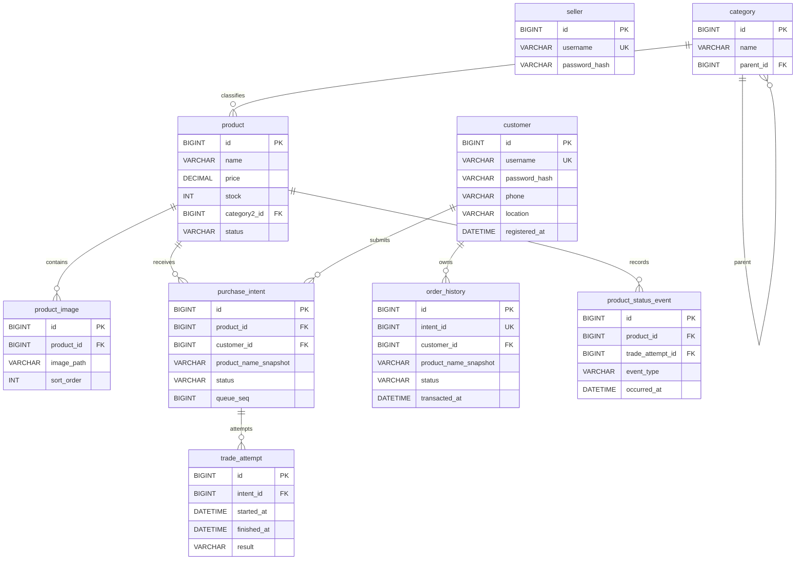

# 数据库设计与使用说明

## 1. 数据库概况

系统使用 MySQL 8.0.16+、InnoDB 和 utf8mb4。商品图片文件保存在上传目录，数据库保存其路径。业务时间统一为 `Asia/Shanghai`，数据库使用 `DATETIME(6)` 保存微秒精度的本地时间。

| 表 | 用途 |
| --- | --- |
| `seller` | 卖家账号与密码哈希 |
| `customer` | 顾客账号、联系方式和注册时间 |
| `category` | 二级分类及其父分类 |
| `product` | 商品描述、价格、库存、分类及状态 |
| `product_image` | 商品图片路径和显示顺序 |
| `purchase_intent` | 顾客对商品的购买意向及当前队列状态 |
| `trade_attempt` | 每次开始交易及其最终结果 |
| `order_history` | 顾客可见的成功/失败终态快照 |
| `product_status_event` | 商品发布、上下架及交易状态事件 |

空库基线为 [schema.sql](../../backend/src/main/resources/db/schema.sql)；实体映射位于 [entity](../../backend/src/main/java/com/team/shop/entity)，数据查询位于 [repository](../../backend/src/main/java/com/team/shop/repository)。`DataInitializer` 在启动时填充默认分类和初始卖家账号。

## 2. ER 图



所有业务实体使用主键关联；删除采用受外键保护的限制策略，不级联清除购买或交易历史。

## 3. 主要字段和状态

- `product.stock` 为非负库存；`category2_id` 必须指向二级分类。`product.status` 为 `ONLINE`、`FROZEN` 或 `OFFLINE`。卖家只能对正库存商品执行上架；补充库存本身不会自动上架。
- `product_image` 按 `sort_order` 保存最多 9 张图片；没有图片时 `mainImagePath` 为空。
- `purchase_intent.customer_id` 对新意向必填业务关联；数据库字段允许为空，以兼容迁移前的旧数据。新 API 必须经顾客认证才能创建意向。`product_name_snapshot` 保存提交时商品名。
- 意向状态为 `QUEUING`、`IN_TRANSACTION`、`SUCCESS`、`FAILED`、`CANCELLED`。`queue_seq` 在同一商品内唯一；重排分配新序号，首次提交时间不变。
- `trade_attempt` 记录一次交易过程，未结束时 `finished_at/result/fail_action` 均为空；成功结果没有失败动作，失败结果必须包含 `REQUEUE` 或 `DISCARD`。
- `order_history` 仅保存 `SUCCESS` / `FAILED` 终态快照，每个意向至多一条。`REQUEUE` 不是终态，不生成历史；旧口令时代的顾客身份和意向不转换成顾客购买历史。
- `product_status_event` 记录发布、手动上下架、库存归零下架和交易状态变更；可选关联交易尝试。

## 4. 约束与事务

主要数据库约束包括：账号名唯一、商品价格大于 0、库存非负、队列序号按商品唯一、同一商品至多一个 `IN_TRANSACTION` 意向、每个意向至多一个未完成交易尝试、每个意向至多一条订单历史，以及终态/尝试结果约束。`CHECK` 约束需要 MySQL 8.0.16+。

交易开始、结果确认、库存扣减、订单历史写入及队列清理在服务事务中完成。商品行使用悲观写锁；队列排序按 `(queue_seq, id)`，而不是依赖意向 ID。重排移至对应商品队尾，不会自动开始下一笔。

## 5. 首次建库

在项目根目录执行以下 PowerShell 命令，`-p` 将交互式提示输入本地密码：

```powershell
mysql -uroot -p --default-character-set=utf8mb4 -e "CREATE DATABASE shop CHARACTER SET utf8mb4;"
mysql -uroot -p --default-character-set=utf8mb4 shop -e "source backend/src/main/resources/db/schema.sql;"
```

已有 `shop` 库时先确认表结构与数据；`CREATE TABLE IF NOT EXISTS` 不会更新旧表。应用配置为 `ddl-auto: none`、`sql.init.mode: never`，启动时不会自动迁移数据库。

Compose 的空 MySQL 数据卷会导入同一份 schema；已存在的数据卷不会重放初始化脚本。空库启动时由应用初始化基础分类与卖家账号。

## 6. 已有库升级

升级前停止写入，备份数据库并在独立副本完成恢复演练。迁移使用 MySQL 客户端运行 SQL 文件，不要启用 `--force`：

1. 旧三表数据库先结束所有 `IN_TRANSACTION` 交易，再执行 [V2 队列与历史迁移](../../backend/src/main/resources/db/migrations/V2__queue_history.sql)。
2. 已执行旧版 V2 的数据库按需执行 [V3 交易结果约束迁移](../../backend/src/main/resources/db/migrations/V3__trade_attempt_completion_check.sql)；新建库及修订版 V2 无需额外运行 V3。
3. 在任何交易中意向均已结束的前提下执行 [V4 迭代 2 迁移](../../backend/src/main/resources/db/migrations/V4__iteration2_customer_inventory_catalog.sql)。
4. 核对数据行数、商品/意向状态、中文内容和队列序号；由卖家核实每件旧商品的实际库存，按需补库存并手动上架。

旧版没有保存库存，因此 V4 将原有商品安全地设为 `stock=0`、`OFFLINE`，不会猜测库存；原有排队意向转为失败，不会伪装成已登录顾客的历史。迁移前商品图像路径会保留。迁移不会自动创建顾客账号，也不会把旧口令记录显示为新顾客购买历史。

MySQL DDL 会隐式提交。V4 含前置检查，发现未结束交易或已存在迭代 2 列时会拒绝运行。迁移若在其他位置中断，先核对实际表结构与备份，不要盲目重跑。回退应停写并恢复已演练的备份；直接运行旧程序写入会破坏新数据语义。

备份示例：

```powershell
mysqldump -uroot -p --single-transaction --routines --triggers --default-character-set=utf8mb4 --result-file=shop-before-upgrade.sql shop
```

备份文件含账号和个人信息，存放于受控位置，不应提交到 Git。

## 7. 验证

运行 `mvn -B -ntp -f backend/pom.xml clean verify` 可执行当前后端测试，包括基于 H2 的 HTTP 集成测试。V4 迁移使用 MySQL 特定 DDL，尚未在真实 MySQL 副本验证；应在部署前按第 6 节备份并演练。旧版 [verify_database.py](../../scripts/verify_database.py) 面向 V1 schema/API，不适用于迭代 2。旧结果见[历史数据库验证报告](../test/db-validation.md)，不代表本次 V4 已通过 MySQL 验证。
