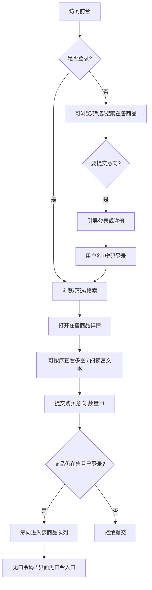
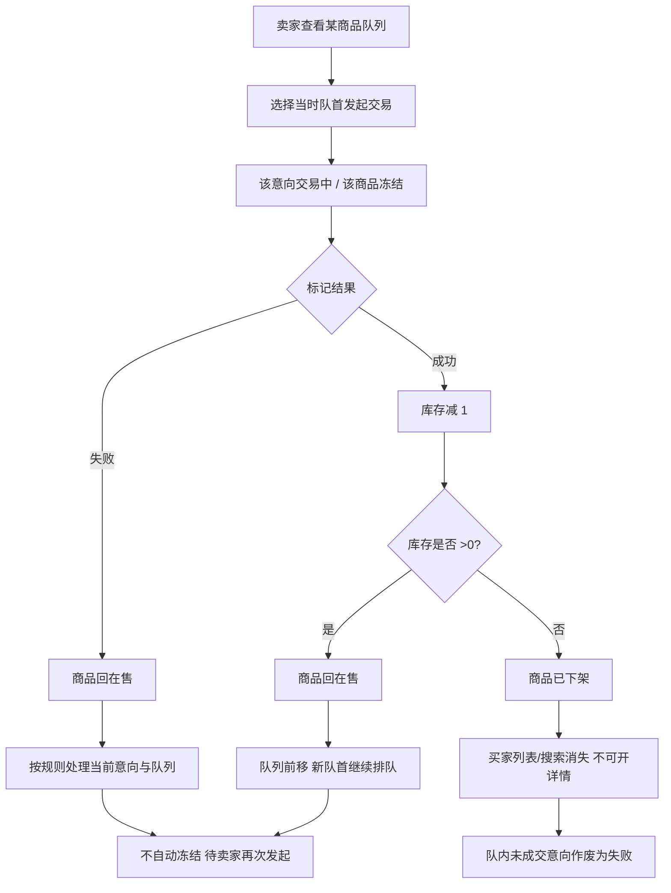
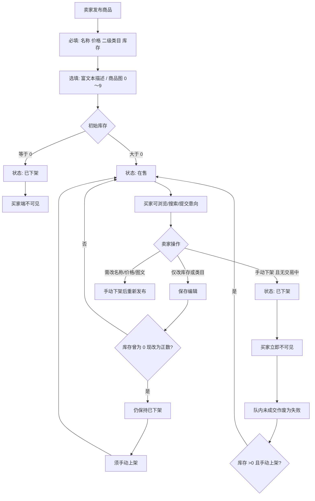
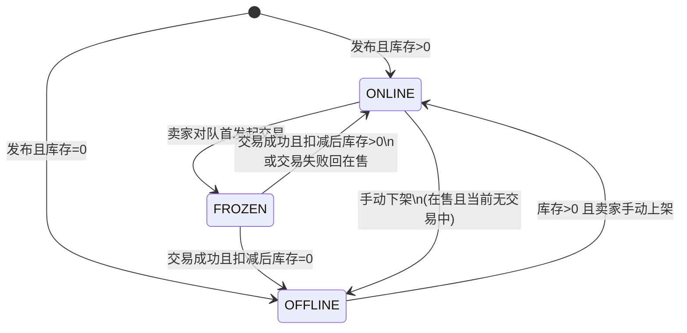
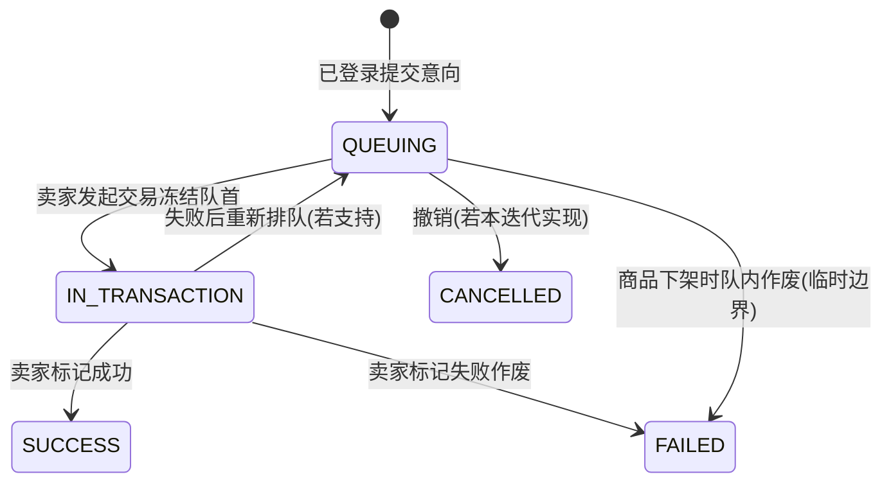

# OxStore 在线购物系统需求规格说明书（迭代2）

> **文档说明：** 本文档为迭代2 需求规格说明书，**目录结构沿用**组仓库 Wiki「[需求规格说明书V1](https://github.com/Wen5555/OxStore/wiki/%E9%9C%80%E6%B1%82%E8%A7%84%E6%A0%BC%E8%AF%B4%E6%98%8E%E4%B9%A6V1)」；业务内容以产品待办（PB-01～08）已裁定规则为准，**不以 V1 的口令码 / 单商品规则为准**。

| 项 | 内容 |
| --- | --- |
| 当前版本 | V2.1-draft |
| 日期 | 2026-10-22（Asia/Shanghai） |
| 权威依据 | `docs/iteration2/product-backlog.md` v2.0（PB-01～08） |
| 维护 | 产品负责人维护待办与本规格；开发/测试以本规格验收 |

---

## 一、引言

### 1.1 文档目的

本文档定义 OxStore 在线购物系统**迭代2**的功能需求、非功能需求及业务流程，为开发、测试和验收提供依据。相对迭代1（Wiki V1），本迭代由「单卖家、单商品、买家凭口令码匿名提交意向」演进为「多商品同时在售、顾客注册登录后提交意向、按商品独立队列与库存管理、多图与富文本描述、商家查看顾客与购买历史」。

### 1.2 项目范围

- **包含（本 Sprint / 迭代2）：** 多商品发布与按商品独立队列/冻结；废除口令码；库存与零库存自动下架；手动下架与手动上架；发布后仅可编辑库存与二级类目；二级类目树及买家二级筛选；浏览/搜索（仅在售，搜索先剥标签再匹配纯文本）；顾客注册与登录；登录后历史订单（仅成功/失败终态）；多图展示与富文本描述；商家查看全部顾客与按顾客购买历史；卖家后台在基线上按上述规则扩展。
- **不包含（明确排除）：** 口令码提交与自助管理；购物车与一次购买多件；线上支付与物流；多卖家；自动超时解冻；「待课程组确认」项的正式实现（见「八、范围排除」中的临时边界）。

### 1.3 术语表

| 术语 | 说明 |
| --- | --- |
| 买家 / 顾客 | 前台用户。可匿名浏览与搜索在售商品；须注册并登录后方可提交购买意向与查看本人历史订单。 |
| 卖家 | 系统卖家管理员，使用预置（或既有）账号登录后台，负责多商品发布与有限编辑、上/下架、按商品队列与交易确认、顾客与购买历史查看。 |
| 在售 | 商品状态之一：出现在买家列表与搜索中，可打开详情并（已登录时）提交购买意向。 |
| 冻结 | 商品状态之一：仅由卖家对该商品当时队首**发起交易**触发；不出现在列表/搜索；持有详情直链可只读查看，不可提交意向；按商品独立，冻结 A 不影响 B。 |
| 已下架 | 商品不可被买家列表/搜索发现，**详情不可打开**，不可提交意向。可由零库存自动下架或卖家手动下架产生；初始库存为 0 发布时亦为已下架。 |
| 购买意向 / 意向 | 已登录顾客对某件在售商品提交的购买意愿；每笔数量固定为 1；进入该商品的意向队列；**不**扣减库存。 |
| 意向队列 / 队首 | 每件商品各自维护一条按提交顺序排列的意向队列，商品之间互不影响（排队隔离）。队首为该队列当前第一位；仅卖家对队首发起交易才会冻结。 |
| 发起交易 | 卖家对某在售商品当时队首执行的操作：该意向进入交易中，该商品进入冻结；其他商品不受影响。 |
| 交易成功 | 卖家将交易中意向标记为成功：库存减 1。若库存仍 >0，商品回在售、队列前移，**新队首不自动冻结**；若库存 =0，商品自动已下架。 |
| 交易失败 | 卖家将交易中意向标记为失败：商品回在售；队列按规则递补；须卖家再次发起交易才冻结新队首。 |
| 库存 | 商品可成交件数。提交意向、排队、冻结均不改变库存；**仅**交易成功时减 1。将库存从 0 改为正数**不会**自动上架。 |
| 零库存自动下架 | 交易成功后若库存变为 0，商品自动变为已下架；买家端立即不可见、不可开详情。 |
| 手动下架 | 卖家在商品在售、且该商品当前无交易中意向时执行：商品变为已下架（库存仍可 >0）；买家立即不可见。 |
| 手动上架 | 卖家对已下架且库存 >0 的商品执行上架：变为在售，出现在买家列表/搜索；不必重新发布。 |
| 二级类目 | 发布必填的商品分类节点；买家可按某一二级类目筛选在售商品；发布后卖家可编辑二级类目（名称/价格/描述/图片不可原地改）。 |
| 商品名快照 | 历史订单中保留的成交当时商品名称文本；不随后续改名或重新发布而回写。 |
| 富文本描述 | 商品详情中的可选描述（可含插图）；列表/搜索卡片不展示描述摘要；搜索时先剥标签再匹配纯文本。 |
| 多图 / 主图 | 商品图 0～9 张；详情可按序查看全部图。主图为列表/搜索卡片展示的代表图；无图时显示占位图。 |
| 历史订单 | 已登录顾客本人的成功/失败终态记录（含商品名快照等）；不含排队中、交易中等进行中态。卖家侧可按顾客查看同类终态记录（只读）。 |
| 会话 / 登录 | 顾客或卖家通过用户名与密码校验后建立的登录状态；未登录不可提交意向、不可访问卖家后台与本人历史订单。 |
| 直链 | 商品详情页的直接/分享链接。冻结商品不在列表/搜索中，持有直链可只读打开；已下架商品即使有直链也拒绝打开。 |
| 数量固定为 1 | 每笔购买意向与每笔交易的商品数量恒为 1；不支持购物车或一次购买多件。 |
| 排队隔离 | 各商品意向队列相互独立；对某一商品的排队、冻结与成交不影响其他商品。 |
| 口令码（已废除） | 迭代1 匿名提交/自助管理意向的凭据。本迭代**已废除**：不生成、不校验、界面无入口；不得作为未登录提交旁路。 |

---

## 二、系统概述

### 2.1 系统目标

构建可用的多商品意向交易系统，实现以下核心目标：

- 卖家可同时维护多件在售商品，每件商品有独立意向队列与冻结；每笔交易固定数量为 1
- 顾客注册登录后提交购买意向；界面无口令码入口；系统不再提供口令码提交流程
- 卖家对某商品队首发起交易时才冻结该队首；成交成功扣库存 1；库存仍 >0 则回在售并队列前移（不自动冻结）；库存 =0 则自动下架
- 卖家可在库存仍 >0、且该商品当前无交易中意向时，将在售商品手动下架；库存 >0 时可再手动上架（不必重新发布）
- 发布后仅可编辑库存与二级类目；名称、价格、描述、图片不可原地修改；变更名称/价格/图文须下架后重新发布
- 买家可按二级类目筛选、按关键词搜索在售商品；搜索先剥标签再匹配名称与描述纯文本；未登录可浏览与搜索
- 详情页可按序查看全部商品图（最多 9 张），并阅读富文本描述（含插图）；列表/搜索卡片不展示描述摘要
- 已登录顾客可查看本人成功/失败终态历史订单（商品名快照）
- 卖家可查看全部注册顾客，并进入某位顾客的成功/失败购买历史（只读）

### 2.2 系统范围

系统包含两大子系统：

- **买家前台：** 注册/登录、商品浏览与二级筛选、搜索、商品详情（多图按序查看、富文本只读、冻结直链只读）、提交购买意向、历史订单（成功/失败）
- **卖家后台：** 卖家登录、商品发布、编辑（仅库存与二级类目）、手动上架、手动下架、按商品意向队列、发起交易（冻结队首）、标记交易成功/失败、历史记录、顾客列表、按顾客购买历史（只读）

---

## 三、用户角色与用例

### 3.1 用户角色定义

**买家（顾客）：** 可匿名浏览与搜索在售商品；须注册并登录后方可提交购买意向与查看本人历史订单。本迭代废除口令码，买家不再凭口令码自助查询/修改/撤销意向。

**卖家：** 系统卖家管理员，使用预置（或既有）账号登录后台，负责多商品发布与有限编辑、手动上/下架、按商品队列管理、交易确认、库存与类目维护、顾客列表与购买历史查看。卖家侧沿用迭代1 后台能力并按本规格扩展。

### 3.2 买家核心用例

| 用例ID | 用例名称 | 前置条件 | 主流程 | 预期结果 | 优先级 |
|--------|----------|----------|--------|----------|--------|
| B-001 | 顾客注册 | 用户名未被占用 | 1. 填写用户名、密码、电话（必填）及默认交易地点（选填） 2. 系统校验格式与唯一性 3. 密码哈希入库 4. 完成注册 | 账号创建成功，可登录 | 高 |
| B-002 | 顾客登录 | 已注册 | 1. 输入用户名与密码 2. 系统校验 3. 建立会话 | 登录成功，可提交意向与查看历史 | 高 |
| B-003 | 浏览在售商品列表 | 无（未登录亦可） | 买家打开列表；系统仅返回「在售」商品 | 展示名称、价格、主图、所属类别；不展示描述摘要；无在售时给出空态 | 高 |
| B-004 | 按二级类目筛选 | 存在二级类目树 | 买家选择某一二级类目；系统过滤在售商品 | 仅展示该类目下在售商品 | 高 |
| B-005 | 关键词搜索 | 无（未登录亦可） | 买家输入关键词；系统先剥描述标签，再匹配名称与描述纯文本（不匹配类别） | 结果仅含在售商品；展示名称、价格、主图、类别；不展示描述摘要 | 高 |
| B-006 | 查看在售商品详情 | 商品状态为在售 | 买家从列表/搜索进入详情；可按序切换查看全部商品图；阅读富文本描述 | 展示完整信息（含库存、多图、富文本）；提供提交意向入口（已登录可用）；空描述不展示描述区 | 高 |
| B-007 | 经直链查看冻结商品 | 商品状态为冻结；买家持有详情直链/分享链接 | 买家打开直链；系统只读展示商品信息（含多图按序查看） | 可看详情与多图；不可买、不可提交意向；冻结商品不在列表/搜索中 | 高 |
| B-008 | 打开已下架商品详情 | 商品已下架（含库存 0、手动下架） | 买家尝试打开详情 | 拒绝打开；不可提交意向 | 高 |
| B-009 | 提交购买意向 | 已登录；目标商品在售 | 1. 买家确认提交（数量固定为 1） 2. 服务端校验登录与商品状态 3. 意向入该商品队列 | 意向进入排队；未登录被拒绝；无口令码 | 高 |
| B-010 | 查看历史订单 | 已登录 | 买家打开历史；系统仅返回本人成功/失败记录，倒序分页 | 每条含商品名快照、下单时间、结果、交易时间；不含进行中态 | 高 |
| B-011 | 未登录访问历史 | 未登录 | 买家访问历史入口 | 引导登录 | 高 |

### 3.3 卖家核心用例

| 用例ID | 用例名称 | 前置条件 | 主流程 | 预期结果 | 优先级 |
|--------|----------|----------|--------|----------|--------|
| S-001 | 卖家登录 | 系统已有卖家账号 | 1. 输入用户名和密码 2. 校验 3. 进入后台 | 登录成功，可访问后台 | 高 |
| S-002 | 修改卖家密码 | 卖家已登录 | 1. 输入原密码与新密码 2. 校验强度（≥8） 3. 更新哈希 | 密码修改成功 | 中 |
| S-003 | 发布商品 | 卖家已登录 | 1. 填写名称、价格、二级类目、库存（必填）；描述（富文本选填）、商品图 0～9 张（选填） 2. 校验图片格式/大小 3. 创建商品 | 库存>0 则为在售；库存=0 则立即已下架且买家不可见 | 高 |
| S-004 | 编辑商品（有限） | 卖家已登录；商品存在 | 卖家仅修改库存数量与/或二级类目并保存 | 更新成功；名称/价格/描述/图片不可改；库存从 0 改为正数**不会**自动上架 | 高 |
| S-005 | 手动上架 | 商品已下架且库存>0 | 卖家在后台执行上架 | 商品变为在售，出现在买家列表/搜索 | 高 |
| S-006 | 手动下架 | 商品在售；该商品当前无交易中意向 | 卖家在后台执行手动下架 | 商品变为已下架；买家立即不可见、不可开详情、不可提交意向；库存仍可>0；队内未成交意向按临时边界作废为失败 | 高 |
| S-007 | 查看商品列表与状态 | 卖家已登录 | 进入商品管理 | 可见多件商品及其状态、库存、类目等 | 高 |
| S-008 | 查看某商品意向队列 | 卖家已登录 | 进入该商品意向管理 | 按提交顺序展示该商品意向；与其他商品队列互不影响 | 高 |
| S-009 | 对队首发起交易（冻结） | 该商品在售；队列非空；该商品当前无交易中意向 | 卖家对该商品当时队首发起交易 | 该意向→交易中；该商品→冻结；其他商品不受影响 | 高 |
| S-010 | 确认交易成功 | 该商品存在交易中意向 | 1. 标记成功 2. 库存减 1 3. 按库存更新商品状态与队列 | 库存>0：回在售，队列前移，新队首不自动冻结；库存=0：已下架，买家端不可见不可开详情；队内未成交按临时边界处理 | 高 |
| S-011 | 确认交易失败 | 该商品存在交易中意向 | 卖家标记失败（作废或重新排队等处理以实现与基线扩展为准，且须符合「新队首不自动冻结」） | 商品回在售；队列按规则递补；须卖家再次发起交易才冻结新队首 | 高 |
| S-012 | 查看历史商品/意向 | 卖家已登录 | 进入历史 | 历史数据可查；与买家端终态展示独立；与顾客购买历史页面本轮不做互相跳转 | 中 |
| S-013 | 查看全部顾客 | 卖家已登录 | 进入顾客列表；按注册时间倒序分页 | 展示全部已注册账号（含从未下单者）；每行含用户名、完整电话、默认交易地点（未填显示「未设置」）、注册时间 | 高 |
| S-014 | 查看顾客购买历史 | 卖家已登录；已从顾客列表进入某顾客 | 查看该顾客成功/失败终态记录 | 每条含商品名快照、下单时间、结果、交易时间；只读；不含进行中态；不做价格/地点字段 | 高 |

---

## 四、业务流程

### 4.1 顾客注册登录与提交意向流程

### 4.2 卖家按商品发起交易与成交扣库存流程

### 4.3 商品发布、编辑、手动下架与上架流程

### 4.4 状态机定义

**商品状态：**

- `ONLINE`（在售）：可出现在买家列表/搜索；可接收该商品的新购买意向（须登录）
- `FROZEN`（已冻结/交易中）：不出现在列表/搜索；仅详情直链可打开且只读（多图按序查看交互与在售一致）；不可提交意向；冻结按**商品**独立，冻结 A 不影响 B
- `OFFLINE`（已下架）：含库存扣减至 0 的自动下架、创建时库存为 0、以及卖家手动下架；买家端不可打开详情、不可提交意向；库存从 0 改为正数后**不会**自动回到在售，须卖家手动上架；手动下架后若库存 >0，亦可手动上架回到在售（不必重新发布）

**意向状态：**

- `QUEUING`（排队中）：在对应商品队列中等待
- `IN_TRANSACTION`（交易中）：已被卖家选为该商品当前交易对象
- `SUCCESS`（交易成功）：终态；计入买家历史与商家侧顾客购买历史
- `FAILED`（交易失败）：终态；计入买家历史与商家侧顾客购买历史；含手动下架/库存到 0 时队内未成交作废（临时边界）
- `CANCELLED`（已撤销）：若实现撤销则记此态；**买家端与商家侧购买历史本 Sprint 均不展示**中间态与已撤销（见范围排除）

**状态迁移约束：**

- 允许多件商品同时 `ONLINE`；无同时在售数量上限
- 每件商品各自一条意向队列；对 A 冻结不影响 B 的浏览与提交意向
- 任意一件商品在任意时刻至多一条意向处于 `IN_TRANSACTION`
- 仅该商品队首的 `QUEUING` 意向可被发起交易
- 卖家发起交易时，才将「当时该商品队首」冻结；新队首**不会**自动冻结
- 每笔交易固定数量为 1；提交意向、排队、冻结均不改变库存
- **仅**卖家标记「交易成功」时对应商品库存减 1
- 手动下架前置：商品为 `ONLINE`，且该商品当前无 `IN_TRANSACTION` 意向
- 手动下架与库存到 0 自动下架时，队内未成交意向按临时边界**作废为失败**（清空队列）
- 已废除口令码：不生成、不校验、界面无入口
- 发布后不可原地修改名称、价格、描述、图片；可修改库存与二级类目

---

## 五、功能需求详述

### 5.1 买家端功能

#### 5.1.1 顾客注册与登录

**功能描述：** 新顾客使用用户名、密码、电话注册；使用用户名 + 密码登录，以便提交意向与查看历史。

**输入字段（注册）：**

| 字段 | 约束 |
| --- | --- |
| 用户名 | 必填；全局唯一；重复不可注册 |
| 密码 | 必填；长度 ≥8；不以明文存储（哈希） |
| 电话 | 必填；不作登录账号 |
| 默认交易地点 | 选填 |

**处理流程：**

1. 顾客填写注册信息并提交
2. 前端做基础非空与长度提示；服务端校验唯一性与密码长度
3. 密码哈希后持久化；注册无需验证码
4. 登录时校验用户名 + 密码，建立会话

**验证逻辑：**

- 电话不作登录凭证
- 未登录可浏览/搜索；未登录无法提交购买意向（无口令码旁路）
- 本 Sprint 不做：修改个人资料、失败次数锁定、电话唯一性等未裁定规则（按最简或不做，见第八章）

#### 5.1.2 商品浏览、二级筛选与搜索

**功能描述：** 买家浏览在售商品，可按二级类目筛选，可按关键词搜索。

**展示规则：**

- 浏览列表与搜索结果**仅包含「在售」**商品
- 未登录可浏览与搜索
- 每条至少展示：名称、价格、主图、所属类别；**不展示描述摘要**；**库存仅在详情页展示**
- 主图 = 第一张**商品图**；若无商品图，列表/搜索/详情统一显示占位图；描述中的插图**不得**充当主图
- 「已冻结」不出现在列表/搜索
- 「已下架」不出现在列表/搜索

**二级类目：**

- 系统存在可用的一级→二级类目树
- 买家端支持按**二级**类别筛选；缺筛选或未实现二级类目均视为本条未完成

**搜索：**

- 描述若为富文本，须**先剥标签**，再按名称与描述**纯文本**匹配
- **不匹配类别**
- 结果仅在售
- 分页条数、模糊/精确、大小写、默认排序、空关键词与无结果文案：按团队最简可运行方案，不单列加分项

#### 5.1.3 商品详情、多图与富文本

**功能描述：** 买家查看商品详情；在售详情可按序查看全部商品图并阅读富文本描述；在售且已登录时可提交购买意向。

**在售详情：**

- 展示完整信息（含库存、商品图、富文本描述）
- 详情页必须能查看该商品全部商品图（最多 9 张）；验收为可按序前后切换看完即可，不要求缩略图条或自动轮播
- 描述选填；最低支持：换行、加粗、斜体、列表，以及插图；禁止：脚本/互动组件、复杂表格、公式；视频嵌入本轮不做
- 空描述判定：先剥标签并去除空白后无可读文字 → 详情**不展示描述区**
- 描述中的插图与商品图**分开计数**，不占用「最多 9 张」名额；插图不得充当主图或占位图替代
- 已登录：提供提交意向入口；每单数量固定为 1，不可一次购买多件
- 未登录：不可提交；应引导登录（无口令码入口）

**冻结详情：**

- 不在列表/搜索中；唯一合法入口为详情直链 / 分享链接
- 打开后只读：不可买、不可提交意向
- 多图查看交互与在售详情一致（可按序看完全部商品图）

**已下架详情：**

- 买家端不允许打开详情，不可提交意向（含库存到 0 自动下架与手动下架）

**处理流程（提交意向）：**

1. 校验已登录
2. 校验目标商品实时为在售
3. 生成意向，数量=1，进入该商品队列（按提交顺序）
4. **不**生成口令码；**不**改变库存

**验证逻辑：**

- 商品非在售（含冻结、已下架）时拒绝提交
- 并发提交不得丢失已成功接收的意向
- 界面与流程中不得出现口令码入口

#### 5.1.4 历史订单（终态）

**功能描述：** 已登录顾客查看本人已有明确结果的历史订单。

**展示规则：**

- 未登录访问时引导登录
- 仅展示当前用户本人、且结果为成功或失败的记录
- **不展示**排队中、交易中、已撤销
- 每条至少含：商品名称（下单时快照）、下单时间、交易结果（成功/失败）、交易时间
- 按时间倒序；支持分页
- 商品后续下架或删除，不影响已有历史展示；商品名仍为快照
- 注册前口令码时代意向：**不迁移、不展示**
- 进行中意向：买家端本轮不提供跟进入口

**验证逻辑：**

- 不得展示他人订单
- 不得把中间态混入本轮历史列表

### 5.2 卖家端功能

#### 5.2.1 卖家认证

**功能描述：** 卖家登录后台；可修改密码（沿用基线安全要求之适用部分）。

**验证逻辑：**

- 未登录不得访问后台；服务端必须校验身份
- 密码以安全哈希保存，不得明文存储

#### 5.2.2 商品发布、有限编辑、手动下架与上架

**功能描述：** 卖家发布/维护多件商品；发布后字段编辑范围受限；支持手动下架与手动上架。

**输入字段（发布必填）：**

| 字段 | 约束 |
| --- | --- |
| 名称 | 必填 |
| 价格 | 必填 |
| 二级类目 | 必填；必须选到二级；单级文本/单级枚举不可替代 |
| 库存数量 | 必填；≥0 的整数；可为 0 |

**选填：**

| 字段 | 约束 |
| --- | --- |
| 描述 | 富文本选填；最低支持换行、加粗、斜体、列表、插图；禁脚本/互动组件/复杂表格/公式 |
| 商品图 | 0～9 张；仅 JPG/PNG；单张 ≤5MB；上传时字段级校验并拒绝不合规文件；主图 = 第一张商品图；无商品图则前台用占位图 |

**处理流程（发布）：**

1. 校验必填与类目层级；校验商品图格式、单张大小与张数
2. 创建商品：库存 >0 → 在售；库存 =0 → 已下架（买家不可见、不可开详情）
3. 允许多件同时在售；无同时在售数量上限（废除 V1「同时仅一活跃商品」限制）

**发布后可编辑字段（仅限）：**

- 库存数量
- 二级类目

**发布后不可编辑字段：**

- 名称、价格、描述、图片（含商品图与描述插图）
- 本轮不提供商品图的改序、单张删除、单独指定主图

**变更名称 / 价格 / 描述 / 图片的路径：**

- 不可原地修改
- 须手动下架 → **重新发布**（新建商品）
- 主图仍等于商品图上传顺序的第一张

**手动下架：**

- 前置：商品处于「在售」，且该商品当前无交易中意向
- 结果：转为「已下架」；买家端立即不可见、不可打开详情、不可提交意向
- 库存仍可 >0
- 队内未成交意向按临时边界作废为失败（见第八章）

**手动上架：**

- 前置：商品已下架且库存 >0
- 结果：商品变为在售，出现在买家列表/搜索；**不必重新发布**
- 将库存从 0 改为正数后，商品仍保持已下架，须再执行手动上架

#### 5.2.3 按商品意向队列与发起交易

**功能描述：** 每件在售（及处于交易流程中的）商品各自维护意向队列；卖家查看队列并仅对队首发起交易。

**查看队列：** 显示该商品意向的关键信息与顺序；队列按提交顺序稳定排序。

**开始交易：**

- 前置：该商品在售；队列非空；该商品无进行中的交易意向
- 操作：卖家对**当时队首**发起交易
- 结果：该意向 → 交易中；该商品 → 冻结；其他商品浏览与意向不受影响

**验证逻辑：**

- 不得跳过队首任意选择其他买家
- 并发操作不得使同一商品上两条意向同时进入交易
- 新队首不会自动冻结

#### 5.2.4 交易结果与库存

**交易成功：**

1. 该意向标记为交易成功
2. 对应商品库存减 1
3. 若库存仍 >0：商品立即回到在售；该商品队列自动前移，下一位成为新队首并继续排队，**但不自动冻结**；需卖家再次主动发起交易才冻结新队首
4. 若库存 =0：商品变为已下架；立即从浏览列表与搜索消失；买家端不可打开详情、不可提交意向；队内未成交意向按临时边界作废为失败

**交易失败：**

1. 按卖家选择处理当前买家（作废或重新排队等，在符合「新队首不自动冻结」的前提下扩展基线）
2. 商品恢复在售
3. 队列按规则递补；须卖家再次发起交易才冻结

**验证逻辑：**

- 提交意向、排队、冻结均不改变库存
- 买家端不得直接标记交易结果
- 关键状态更新应在一致的业务处理中完成，避免库存与状态矛盾

#### 5.2.5 历史记录（卖家）

**功能描述：** 卖家查看历史商品及相关意向；后台数据完整保留，与买家端「仅终态历史」展示范围可以不同（卖家后台仍可见其业务所需列表）。

**验证逻辑：** 历史数据应可追溯；不得因商品下架而丢失已产生记录。与「按顾客购买历史」「按商品意向队列」本轮相互独立，不做互相跳转。

#### 5.2.6 全部顾客与顾客购买历史

**功能描述：** 卖家查看全部注册顾客，并可进入某位顾客的购买历史（只读）。

**全部顾客：**

- 「全部顾客」= 全部已注册账号，含从未下单、从未提交意向的注册用户；不含未注册访客
- 列表每行至少展示：用户名、电话（商家可见完整电话）、默认交易地点、注册时间
- 默认交易地点未填时，该字段显示固定文案「未设置」
- 列表按注册时间倒序，支持分页；本轮不做搜索/筛选
- 可从顾客进入其「购买历史」
- 本轮不做编辑/禁用/删除顾客账号

**购买历史（按顾客）：**

- 仅含该顾客的成功 + 失败终态；不含排队中、交易中、已撤销（进行中仍只在「按商品意向队列」查看）
- 每条至少含：商品名（下单时快照）、下单时间、交易结果、交易时间
- 本轮不做价格、地点、数量字段（数量固定为 1）
- 商品下架或删除后，商家侧历史仍展示；商品名用快照，规则与买家端一致
- 本轮只要求「按顾客查看购买历史」；不做全站订单总览
- 该购买历史**只读**；不可在此页确认成功/失败或取消意向（交易操作仍在既有交易流程中完成）

---

## 六、非功能需求

### 6.1 性能需求

**响应时间（建议目标，与 V1 同量级）：**

- 页面加载时间：≤3 秒
- API 响应时间：≤2 秒
- 图片上传时间：≤10 秒

**并发处理：**

- 并发提交意向时不得丢失已成功接收的意向
- 并发操作不得使同一商品上两条意向同时进入交易
- 多商品并存时，一商品上的冻结/成交不得错误阻塞其他商品的浏览与提交（除该商品自身状态规则外）

### 6.2 安全需求

**账号与密码：**

- 顾客与卖家密码均以安全哈希保存，不得明文存储
- 顾客密码长度 ≥8
- 修改卖家密码前须验证原密码（若提供改密）

**访问控制：**

- 未登录不得提交购买意向；服务端必须校验，不能只隐藏按钮
- 未登录不得访问后台；公开接口不得返回其他买家的隐私信息
- 买家历史仅返回当前登录用户本人数据
- 商家可见顾客完整电话，仅限已认证卖家后台

**已废除口令码：**

- 不得再提供口令码生成、校验、查询入口
- 不得以口令码作为未登录提交意向的旁路

**富文本安全：**

- 描述禁止脚本与互动组件；服务端应对危险标签做过滤或等效防护

### 6.3 可用性需求

**系统稳定性：**

- 数据须持久化，服务重启后仍保留
- 登录会话策略按最简可运行方案（细则见范围排除中的未裁定项）

**用户友好性：**

- 注册、登录、提交意向、发布、上传图片、交易结果、手动下架/上架等操作应返回清晰的成功或失败提示
- 不以静默失败代替校验结果（含不合规图片上传）
- 校验失败时显示明确错误且不得错误生成意向或错误扣库存

### 6.4 数据持久化需求

**持久化要求：**

- 商品（多实例）、库存、二级类目、顾客账号、购买意向及终态快照、商品图与富文本描述、卖家账号等在服务重启后须保留
- 不能只存放在内存或浏览器中

**时间戳与快照：**

- 意向记录下单时间、交易时间（终态）
- 买家历史与商家侧顾客购买历史中的商品名称使用下单时快照

**数据完整性：**

- 库存非负、类目必须挂到二级、同时多商品在售、商品图张数上限等关键不变量须在服务端（及必要的数据约束）中成立
- 不能只靠前端按钮控制

---

## 七、验收标准

### 7.1 功能验收场景

**场景1：多商品与独立队列（PB-01）**

- 同时存在多件在售商品
- 买家对 A、B 分别提交意向，进入各自队列
- 卖家冻结 A 的队首后，B 仍可浏览并提交意向
- 界面无口令码；未登录无法提交意向
- 每单数量为 1

**场景2：库存与自动下架（PB-02）**

- 创建库存为 0 的商品：立即已下架，买家不可见不可开详情
- 仅标记交易成功时库存减 1；提交/排队/冻结不减库存
- 扣减后 >0：回在售，队列前移，新队首不自动冻结
- 扣减后 =0：已下架，从列表/搜索消失，不可开详情；队内未成交作废为失败（临时边界）
- 库存 0→正数后须手动上架才再在售

**场景3：浏览、二级筛选与搜索（PB-03）**

- 存在二级类目树；发布必须选到二级
- 买家可按二级类目筛选
- 未登录可浏览/搜索；结果仅在售
- 搜索先剥标签再匹配名称与描述纯文本；不匹配类目
- 列表字段含名称、价格、主图、类别；不展示描述摘要；库存仅详情
- 无商品图显示占位图；冻结仅直链只读；已下架不可开详情

**场景4：注册登录（PB-04）**

- 用户名/密码/电话必填，地点选填；密码 ≥8；用户名唯一
- 用户名+密码登录；电话不作登录账号；注册无验证码
- 密码哈希存储；未登录不能提交意向

**场景5：历史订单（PB-05）**

- 未登录访问历史引导登录
- 仅本人成功/失败；含快照名、下单时间、结果、交易时间；倒序分页
- 下架/删除不影响已有历史展示
- 口令码时代意向不迁移不展示；进行中意向买家端不展示

**场景6：手动下架与有限编辑（PB-06）**

- 在售且无交易中时，卖家可手动下架；买家立即不可见/不可开详情/不可提交
- 手动下架后库存 >0 可再手动上架，不必重新发布
- 发布后仅可改库存与二级类目；名称/价格/描述/图片不可改
- 改名称或价格须手动下架后重新发布
- 手动下架时队内未成交作废为失败（临时边界）

**场景7：多图与富文本（PB-07）**

- 商品图选填最多 9 张，JPG/PNG，单张 ≤5MB；不合规上传被字段级拒绝
- 详情可按序看完全部商品图；列表/搜索仅主图；无商品图用占位图
- 冻结直链多图交互与在售一致（只读）
- 富文本支持换行/加粗/斜体/列表/插图；禁脚本等；空描述隐藏描述区
- 插图与商品图分开计数；插图不充当主图
- 搜索剥标签后匹配；列表/搜索卡片无描述摘要

**场景8：商家顾客与购买历史（PB-08）**

- 顾客列表含全部已注册用户（含从未下单）；字段含用户名、完整电话、地点（未填「未设置」）、注册时间；注册时间倒序分页
- 可进入某顾客购买历史；仅成功/失败；快照名 + 下单/结果/交易时间；只读
- 不做账号改禁删、不做搜索筛选、不做三页跳转、不做价格/地点字段

**场景9：主路径串联演示**

- 注册登录 → 浏览/筛选/搜索 → 详情多图与富文本 → 提交意向 → 卖家成交扣库存 → 库存>0 继续卖 / =0 下架 → 手动下架/上架 → 买家历史可见成功/失败 → 卖家查看顾客列表与其购买历史

### 7.2 非功能验收标准

**数据持久化：** 服务重启后业务数据保留；历史快照仍可展示。

**并发安全：** 并发提交不丢失意向；同一商品不出现双交易中意向。

**安全防护：** 密码哈希；未登录无法提交意向与访问后台；无口令码旁路；历史仅本人可见；富文本禁脚本。

---

## 八、范围排除

以下功能明确不纳入**本 Sprint / 迭代2 当前基线**（含「待课程组确认」之临时边界）。**不得**将下表「临时边界」误实现为正式功能需求。

| 排除项 | 说明 / 临时边界 |
|--------|----------------|
| 口令码机制 | **已废除**：不提供口令码提交、查询、修改、撤销；界面无入口 |
| 注册前口令码意向迁移（待确认 1.3） | **临时边界：不迁移、不展示**；不留实现 |
| 进行中意向的买家端跟进（待确认 6.2） | **临时边界：不展示**；仅卖家后台按商品意向列表可见 |
| 手动下架与库存到 0 自动下架时队内未成交意向 | **临时边界：作废为失败**；清空队列；买家端按失败终态规则（若进入历史则可见失败）；卖家后台可见作废结果；本轮不做「保留队列以便再上架后续卖」 |
| 同一顾客多队 / 同商品重复排限制 | 本 Sprint 不实现限制规则 |
| 卖家并行处理多个队首交易 | 本 Sprint 不实现（跨商品独立冻结已要求，不在此列） |
| 购物车与一次购买多件 | 每单固定 1；无购物车 |
| 线上支付 / 物流 / 多卖家 | 不做 |
| 自动超时解冻 | 不做 |
| 修改个人资料、失败锁定、电话唯一等 | 未裁定；按最简或不做 |
| 买家历史筛选/搜索、单条详情、历史内撤销、扩展展示字段 | 不做或最简 |
| 详情多图轮播/缩略图交互形态 | **临时边界：最简**可按序查看全部商品图即可 |
| 商品图总大小上限 | **临时边界：不设总上限**；仅单张 ≤5MB |
| 不合规图片拒绝提示形态 | **临时边界：上传时字段级提示** |
| 富文本视频嵌入 | **临时边界：不做** |
| 描述最大长度 | **临时边界：不设硬上限**（实现自定合理值） |
| 描述插图格式/大小/张数 | **临时边界：最简**不单独设限、不做独立校验 |
| 顾客列表搜索/筛选 | **临时边界：注册时间倒序 + 分页**；不做搜索/筛选 |
| 购买历史价格、地点字段 | **临时边界：不做** |
| 顾客历史 / 卖家历史商品 / 意向队列三页跳转 | **临时边界：不做**（页面独立） |
| 分页/排序/匹配方式等 UI 细则 | 按最简可运行，不单列加分 |
