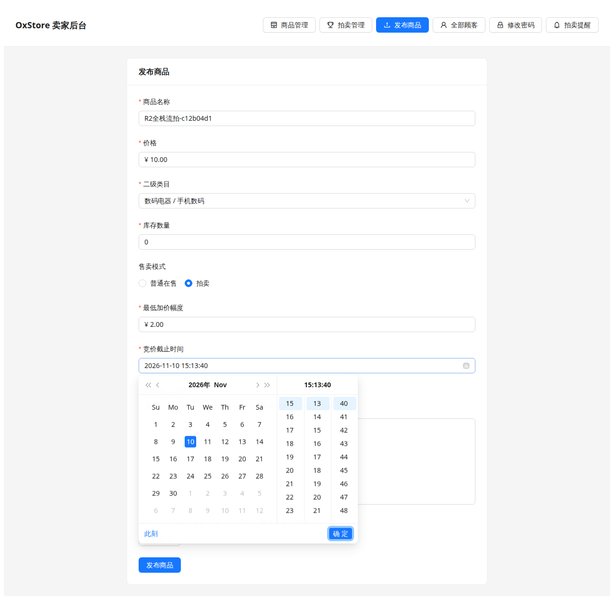
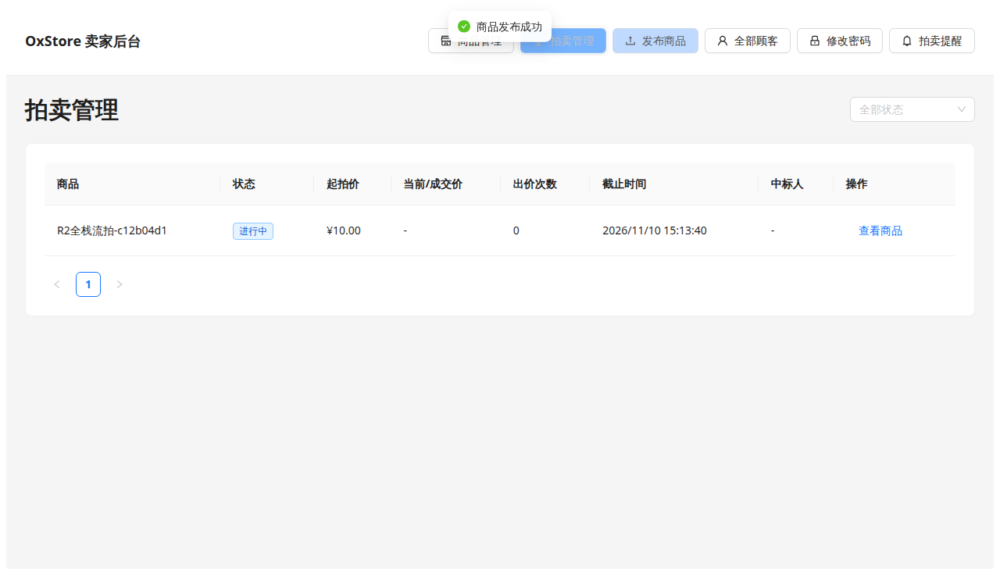
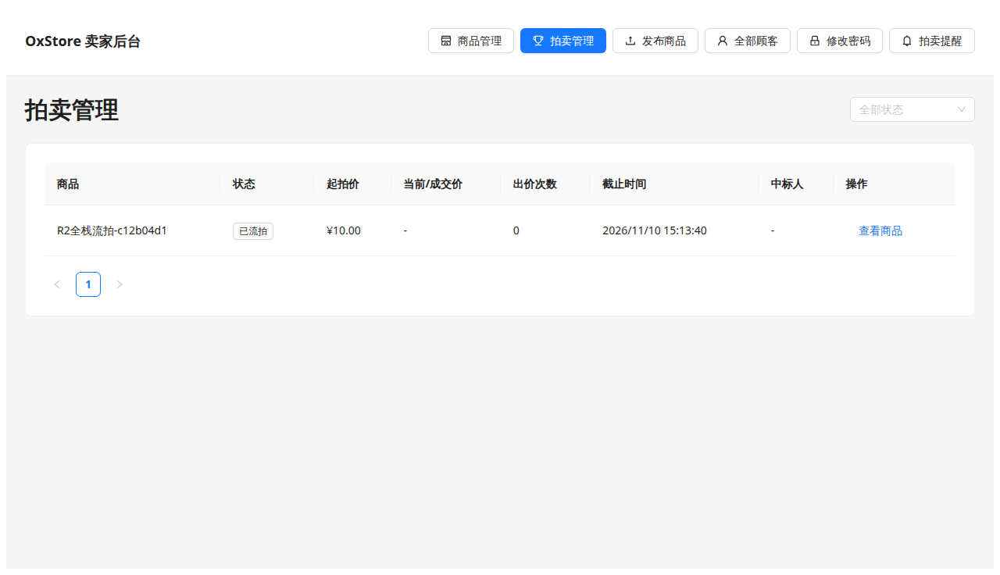
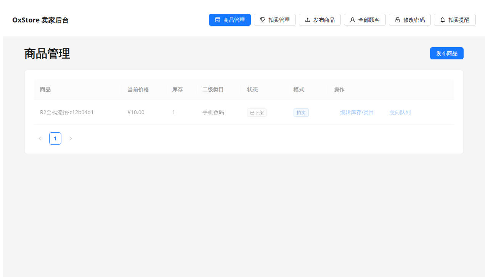
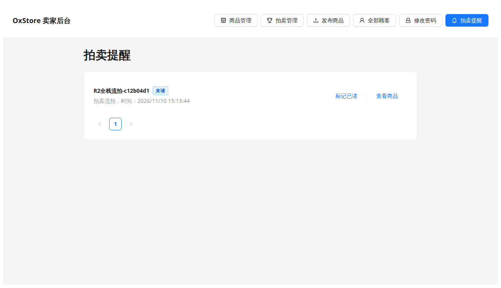

# R2 全栈无人出价流拍补测报告

- 报告日期：2026-11-10（Asia/Shanghai）
- 补测范围：只补测「真实全栈无人出价流拍」一项，不复跑 P-A12～P-A16 整套，不改业务代码
- 被测产品基线：`dbe274586cf5fb8957cf84106dce4fc7fa4b221c`（fork 与组仓 `main` 当时同 SHA）
- 结论：**未全部通过**。定时结拍、数据库/接口无中标人、卖家列表与流拍提醒、重复扫描幂等均通过；卖家从拍卖管理点「查看商品」进入公开详情时，看不到契约流拍文案。

旧轮 131/129/2 是历史结果，**不计入、不覆盖**本次补测。

## 1. 一句话结论

卖家在真实隔离 Docker MySQL + 真实后端 + 无头浏览器中发布无人出价拍卖后，后端 `@Scheduled(fixedDelay = 5000)` 扫描把场次结成 `ENDED_UNSOLD`：无中标人、无中标交易、商品下架、卖家只收到一条「拍卖流拍」提醒且无「处理履约」。公开商品详情被 `getBuyerProduct` 对全部 `OFFLINE` 商品返回 404，页面显示「商品当前不可查看」，契约文案「本次拍卖流拍，无人中标。」未出现。该项按失败记录，未修业务、未放宽断言。

## 2. 本次执行

| 项 | 值 |
| --- | --- |
| 开始 | 2026-11-10 15:12:09 +08:00 |
| 结束 | 2026-11-10 15:14:26 +08:00 |
| 时区 | Asia/Shanghai |
| 被测代码 | `dbe274586cf5fb8957cf84106dce4fc7fa4b221c` |
| 环境 | Linux、JDK 17.0.20.1、Maven 3.9.9、Python 3.12.3、Node 22.23.4、Docker 29.1.3、MySQL 8.0.46 一次性容器、Spring Boot JAR、Vite `:4174`、Playwright Chrome |
| 入口 | `scripts/run_auction_fullstack_e2e.py --scenario unsold --ends-in-seconds 80` |
| 数据库 | 脚本新建隔离库，用完删除；未连接生产或业务库 |
| 整体 | Playwright 退出码 1；库表旁证与重复扫描幂等为真 |

前两次调试失败已留在 `attempts/`，不覆盖本次主证据。

## 3. 时间准备（透明）

截止时间在 MySQL、JAR、Vite 就绪后设为当时起 **80 秒**（契约下限 60 秒）。系统时钟未拨快，测试未调用 `settleOne`，未用 SQL 写入 `ENDED_UNSOLD`。本场截止 `2026-11-10T15:13:40+08:00`，真实扫描结拍 `2026-11-10T15:13:44.188772+08:00`（截止后约 4 秒，符合 5 秒扫描间隔）。

## 4. 覆盖与断言

| 检查 | 期望（PB-A01～A04 / P-A00） | 实际 | 结果 |
| --- | --- | --- | --- |
| 卖家发布无人出价拍卖 | 卖家后台选拍卖、填起拍价/加价/截止并发布 | 发布成功，场次「进行中」，出价 0，无「处理履约」 | 通过 |
| 真实定时结拍 | `@Scheduled scanDueAuctions` 转为流拍 | 截止后约 4 秒变为「已流拍」/`ENDED_UNSOLD` | 通过 |
| 接口无中标人 | `winnerIntentId`/`winnerAlias`/`currentPrice` 为空，`bidCount=0` | 管理列表与快照均如此 | 通过 |
| 数据库无中标交易 | 无 `purchase_intent`、无 `auction_bid`，商品 `OFFLINE` | 意向 0、出价行 0、商品 `OFFLINE` | 通过 |
| 卖家列表 | 「已流拍」，中标人「-」，操作「查看商品」 | 与期望一致 | 通过 |
| 卖家商品管理 | 流拍后下架 | 状态「已下架」，模式「拍卖」 | 通过 |
| 公开/拍卖详情流拍文案 | 「本次拍卖流拍，无人中标。」；出价不可用 | 「商品当前不可查看」，无出价区 | **失败** |
| 卖家流拍提醒 | 一条「拍卖流拍」，无「拍卖已成交」，无「处理履约」，有「查看商品」 | 一条未读「拍卖流拍」，操作是「查看商品」 | 通过 |
| 重复结拍扫描 | 12 秒后再扫，提醒仍 1 条，状态不变 | 提醒仍 1 条 `AUCTION_UNSOLD`，无第二场结拍 | 通过 |

## 5. 失败说明（未修）

拍卖管理「查看商品」进入 `/products/{id}`。前端本可展示流拍文案，但买家商品接口对所有 `OFFLINE` 直接 404「商品已下架」，公开页变成空态。拍卖快照接口本身是 `ENDED_UNSOLD`、出价 0、无领先者。按任务要求不改业务、不放宽「本次拍卖流拍，无人中标。」断言，故 Playwright 记失败。

## 6. 关键截图

卖家发布拍卖（截止约 80 秒）：

无人出价、进行中、无履约入口：

定时结拍后卖家列表为已流拍：

公开详情实际为空态（失败项）：

卖家商品管理已下架：

卖家流拍提醒一条、无履约入口：

再等一个扫描周期后仍一条提醒：

## 7. 库表与接口旁证（本次运行）

结拍后与再等 12 秒后两次快照相同：

- 场次 `ENDED_UNSOLD`，`bid_count=0`，`winner_intent_id` 空，`current_price` 空
- 商品 `OFFLINE` / `AUCTION`
- `purchase_intent` 0 行，`auction_bid` 0 行
- `auction_notification` 仅 `AUCTION_UNSOLD` 1 条
- `GET /api/products/1/auction`：`ENDED_UNSOLD`，出价 0，无领先者
- 卖家拍卖列表：`winnerIntentId`/`winnerAlias` 空
- 卖家提醒：`type=AUCTION_UNSOLD`，`finalPrice` 空

## 8. 不在本次范围

- 不修复公开详情 404，不修复既有 P-A15 OUTBID
- 不复跑模拟 API 套件、成交全栈套件或 Maven 全量
- 不编辑在线 Wiki
- 不把旧轮用例计数混进本次结果
